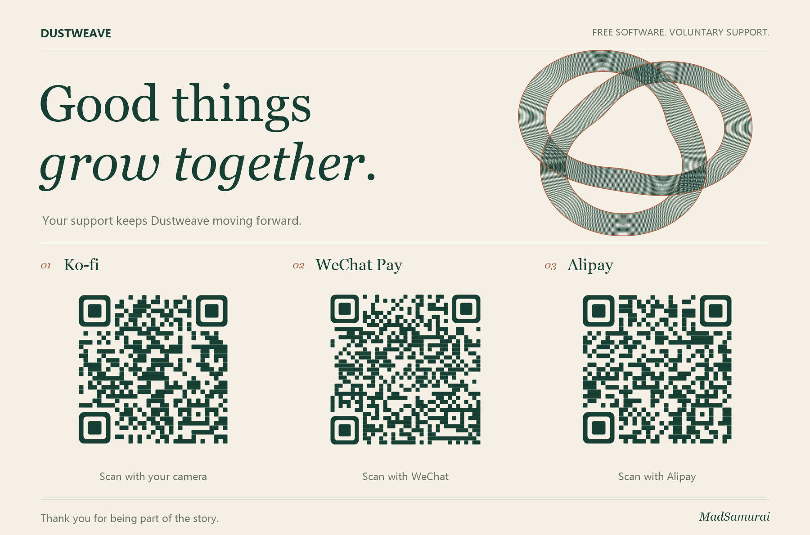
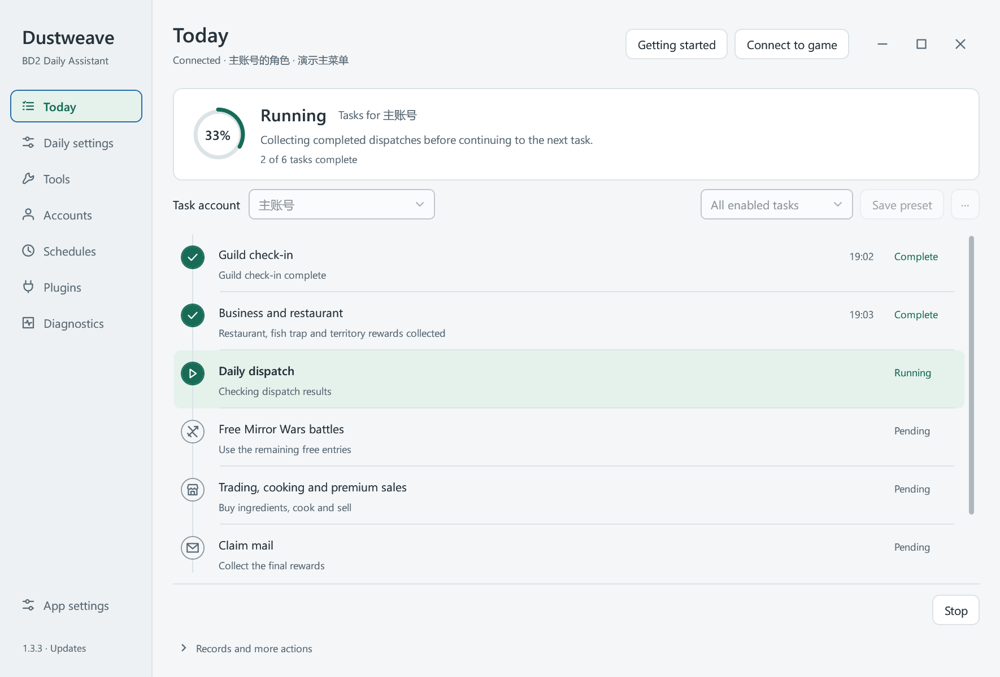
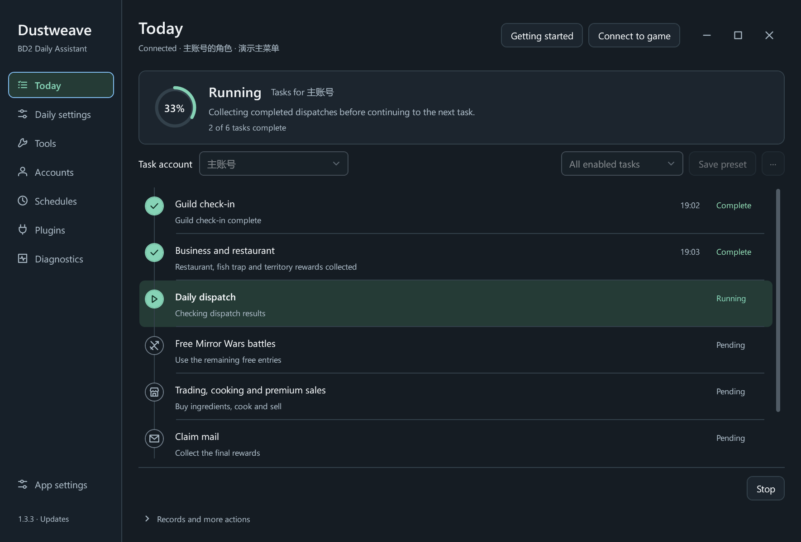

<div align="center">

# Dustweave · 织尘

**Your daily routine, woven into one timeline.**

A multi-account daily assistant for BrownDust II on Windows

[简体中文](README.md) · English

[](LICENSE) [](https://github.com/MadestSamurai/Dustweave/releases/latest)   

[Getting started](docs/GETTING_STARTED.en.md) · [Releases](https://github.com/MadestSamurai/Dustweave/releases) · [Report an issue](https://github.com/MadestSamurai/Dustweave/issues) · [Contributing](CONTRIBUTING.md)

</div>

> Provided free by **MadSamurai** on Bilibili ([MadestSamurai](https://github.com/MadestSamurai) on GitHub). This is an unofficial project. Automation may affect your account or game operation; understand the applicable rules before deciding to use it.

Dustweave brings account switching, daily and weekly tasks, resource management and minigames into one desktop workspace. Set up tasks for each account, review the current plan and follow its progress on a timeline. Disable tasks you do not need or rerun selected unfinished stages.

## Support development

If Dustweave saves you time, consider buying the author a coffee to support ongoing development and maintenance. Donations are entirely optional and do not unlock features or change access to the software. Bug reports, documentation improvements and translations are equally welcome.

[](https://ko-fi.com/D7C1277FLT)

On desktop, use the Ko-fi button above. For WeChat Pay or Alipay, scan with the matching app. [View the full-size QR image](docs/images/support-dustweave-en.png). Thank you for your support!

<details>
<summary>Show QR codes (Ko-fi / WeChat Pay / Alipay)</summary>



</details>

## Preview



<details>
<summary>Show the dark theme</summary>



</details>

Screenshots use fictional accounts in the application's isolated demo mode. The interface supports light, dark and system themes, as well as English.

## What it does

| Capability | What you can do |
| --- | --- |
| Multiple accounts | Save local sessions, assign task presets per account, and run accounts sequentially or in parallel through Sandboxie |
| Daily and weekly tasks | Check-ins, management rewards, affinity consultations, free draws, equipment dismantling/refinement, hunting, dispatch, Mirror battles, event battles, Tower of Salvation sweeps, mission/pass rewards and mail collection |
| Maps and resource management | Enable weekly collection, NPC quests, stealing, trading, cooking, high-price sales and saffron farming as needed |
| A visible execution plan | Follow progress and explanations, save presets, resume queues or rerun selected stages; review completion summaries and optionally notify or exit the game |
| One connection, integrated tools | Share the game connection and coordinate active automation so tasks do not compete for control |
| Scheduled runs and updates | Daily fixed times and account queues; signed background downloads with idle restart confirmation |
| Consistent language and appearance | Simplified Chinese, Traditional Chinese and English across the host and integrated tools |
| Diagnostics and storage | Export diagnostic ZIPs, inspect log/cache usage, apply retention cleanup and relocate the cache |

Some stages require unlocked account content, an active event or a compatible game version. Optional plugins are supported; the interface shows available features.

### Toolbox

Open any of these from Dustweave's **Tools** page; no separate installation is needed. Built-in versions are maintained here and updated with Dustweave. Connection setup, active automation and settlement share control coordination so tools do not operate the game simultaneously.

| Tool | Main features |
| --- | --- |
| [Fishing](src/Fishing) | Fishing, bait management, keep rules and inventory sales |
| [Territory](src/Territory) | Planting, gathering, cooking, inventory sales and layout |
| [Equipment Assistant](src/Equipment) | Powder planning and batch refinement with budget confirmation |
| [Sichuan](src/Sichuan) | Board solving and repeat play |
| [Rhythm](src/Rhythm) | Chart reading and automated input |
| [Apostle Random Defense](src/ApostleDefense) | An offline simulated-annealing-tuned policy for summoning, merging, upgrades, positioning and checkpoint restarts |
| [SECRET VISION](src/SecretVision) | Territory capture, evasion and retries after defeat |
| [Fiend Hunter: Edge of Fury](src/FiendHunter) | Choose a character, monster and solo difficulty; stop after settlement |
| [Infinite Draw](src/InfiniteGacha) | Two target lists, stop conditions and target notifications |
| [MANSION RUNAWAY](docs/MANSION_RUNAWAY.md) | Live navigation, enemy avoidance and stage progression, with an optional 80-chain goal |
| [Pandora Escape](docs/PANDORA.md) | Repeat a selected stage for currency; challenge mode with character selection, weapon/support pairings, boss evasion and late-run survival, stopping on confirmed completion |

The Pandora challenge strategy has reached 20 minutes in one live trial. Character upgrades and random runs still affect the outcome. Automatic equipment selection can be disabled for manual choices.

<details>
<summary>Original repositories and maintenance</summary>

All integrated tools are maintained and released with Dustweave. The original repositories are archived for historical reference; please report current issues here.

- [Equipment Assistant (archived)](https://github.com/MadestSamurai/bd2-equipment-assistant)
- [Fishing (archived)](https://github.com/MadestSamurai/bd2-fishing) · [Territory (archived)](https://github.com/MadestSamurai/bd2-territory)
- [Sichuan (archived)](https://github.com/MadestSamurai/bd2-sichuan) · [Rhythm (archived)](https://github.com/MadestSamurai/bd2-rhythm) · [Apostle Defense (archived)](https://github.com/MadestSamurai/bd2-apostle-defense)
- [SECRET VISION (archived)](https://github.com/MadestSamurai/bd2-secret-vision) · [Fiend Hunter (archived)](https://github.com/MadestSamurai/bd2-fiend-hunter) · [Infinite Gacha (archived)](https://github.com/MadestSamurai/bd2-infinite-gacha)

Equipment Assistant, Apostle Defense, Infinite Gacha, Fiend Hunter, Rhythm, MANSION RUNAWAY and Pandora are maintained under [`src/Equipment/`](src/Equipment), [`src/ApostleDefense/`](src/ApostleDefense), [`src/InfiniteGacha/`](src/InfiniteGacha), [`src/FiendHunter/`](src/FiendHunter), [`src/Rhythm/`](src/Rhythm), [`src/Mansion/`](src/Mansion) and [`src/Pandora/`](src/Pandora). SECRET VISION and Sichuan are maintained under [`src/SecretVision/`](src/SecretVision) and [`src/Sichuan/`](src/Sichuan). Fishing and Territory are maintained under [`src/Fishing/`](src/Fishing) and [`src/Territory/`](src/Territory). All modules retain their attribution and licenses.

</details>

## Download and start

For **Windows x64 and the native BrownDust II PC client**. Python is not required; Android emulators are not the target platform.

| Package | Choose it when | Requirement |
| --- | --- | --- |
| **Portable** | You want an extract-and-run package | Includes the .NET 8 desktop runtime |
| **Lite** | You already have the runtime and prefer a smaller download | [.NET 8 Desktop Runtime x64](https://dotnet.microsoft.com/en-us/download/dotnet/8.0) |

Both packages have the same features. Download a complete package from the [latest GitHub release](https://github.com/MadestSamurai/Dustweave/releases/latest) or the [author's Quark download folder](https://pan.quark.cn/s/0ee553c60c0d?pwd=5AgC) (code **5AgC**). Then:

1. **Extract the entire folder** and run `Dustweave.exe`. Keep the `app` folder beside the executable; it contains data, documentation and licenses.
2. Follow **Getting started** to check the game location, launch and enter the main menu. After character detection, exit normally and save the account. Setup is skippable and can be reopened from the window header.
3. Explore the pages with the highlight tour. Use **Play** in Accounts for future launches, avoiding permission differences from desktop shortcuts or accelerator launch buttons.
4. Configure tasks by category in **Daily settings**, choose the account in **Today**, then use the launch button at the top. It connects directly if the game is already running. For multiple accounts, select them in **Accounts** and run the queue.

Start with a few familiar stages. [Getting started](docs/GETTING_STARTED.en.md) covers updates, data locations and common questions.

**Upgrading from 1.4 or earlier to the 1.5 series requires a manual download of the complete package into a new folder.** Accounts and settings are retained; save Windows startup and schedule settings again to use the new location. You can then check for future updates within the application. If an automatic update cannot be applied or files are damaged, download the complete package from GitHub or Quark.

For a custom game installation, open **App settings → Game & sandbox locations → Change location** and select `BrownDust II.exe`. The choice is saved automatically and shared by all accounts and scheduled runs. You can restore auto-detection or change the Sandboxie installation location here.

Parallel accounts require the stable Windows x64 build of [Sandboxie-Plus](https://sandboxie-plus.com/downloads/); sequential runs do not. If it is unavailable, startup offers a download link, a folder picker and a check-again action. Help is also available under **App settings → Sandboxie location → Installation help**. A scheduled attempt shows one notice and leaves running tools alone. After setup, start the queue manually or wait for the next scheduled run.

Select an account in **Accounts → Manage sandbox** to create or remove its sandbox or repair its binding within the same page. **Software settings → Sandbox compatibility mode** applies to all accounts, including batch and scheduled isolated launches, starting with their next launch. When disabled, Synchronized mode is used. For game updates, close isolated games, update through the host launcher, then launch from Dustweave. Stale program copies are handled while separate login data and resource caches are retained. Removal requires closing the sandbox's game and Dustweave window and confirming the action; saved accounts and main-window settings are kept. After removal, choose **Create a new sandbox**, or let your next isolated launch create one automatically.

**App settings** is at the bottom of the sidebar. It groups appearance, language, startup and closing behavior, installation paths and log cleanup. Starting Dustweave when you sign in to Windows is off by default; running daily tasks when the app opens is a separate option.

## Get help

Check [troubleshooting](docs/GETTING_STARTED.en.md#troubleshooting), then [open an issue](https://github.com/MadestSamurai/Dustweave/issues/new/choose). Include your version, the affected stage, expected and actual behavior, and reproduction steps. Attach only relevant diagnostic excerpts after checking for account identifiers or other personal information.

Use **Diagnostics → Export logs and get help** to save a diagnostic ZIP and send it privately. **WeChat: SuJakads0133** · **QQ: 1104563414**. See [export scope and status explanations](docs/DIAGNOSTICS.md). The Updates page also links to the latest Release and the author's Quark download folder.

Do not upload account directories, credentials, complete inventories or replays. See [SECURITY.md](SECURITY.md) for security reporting.

## Contribute

Dustweave uses C#, .NET and WPF, with runtime-state observation, client adaptation and a shared game connection. The host does not depend on Python. Reproducible reports, translations, documentation improvements and focused fixes are welcome.

```powershell
git clone https://github.com/MadestSamurai/Dustweave.git
cd Dustweave
.\build.ps1
.\test.ps1 -NoBuild
.\check-source.ps1 -AfterBuild
```

Normal builds and synthetic tests neither require nor connect to the game. See the [development guide](docs/DEVELOPMENT.md) for prerequisites and packaging.

[Contributing](CONTRIBUTING.md) · [Architecture](docs/ARCHITECTURE.md) · [Test scope](tests/Dustweave.Tests/README.md) · [Changelog](CHANGELOG.md)

## License and acknowledgements

Dustweave is licensed under [MIT](LICENSE). Integrated tools and third-party components retain their respective licenses. The license grants no rights to game code, assets or trademarks. See [THIRD_PARTY_NOTICES.md](THIRD_PARTY_NOTICES.md) and the [dependency inventory](docs/DEPENDENCIES.md). Game content remains the property of its respective rights holders.

Thanks to the tool and dependency maintainers, testers, translators and users who provide reproducible reports. Dustweave is provided free and does not sell activation codes or paid licenses. Verify downloads through this repository and the author's own channels.

Upgrading from an earlier version: extract the complete package into a new folder and launch `Dustweave.exe`. Existing accounts, settings and history are reused without data migration. Keep old and new program files in separate folders.
