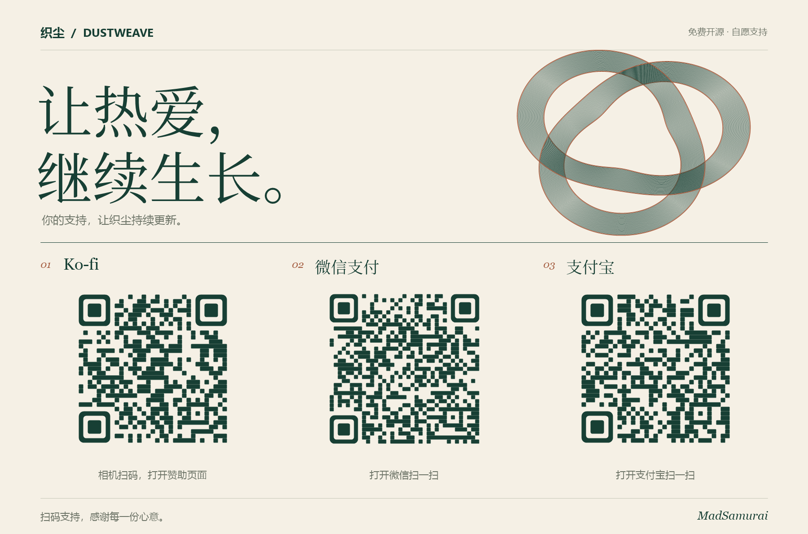
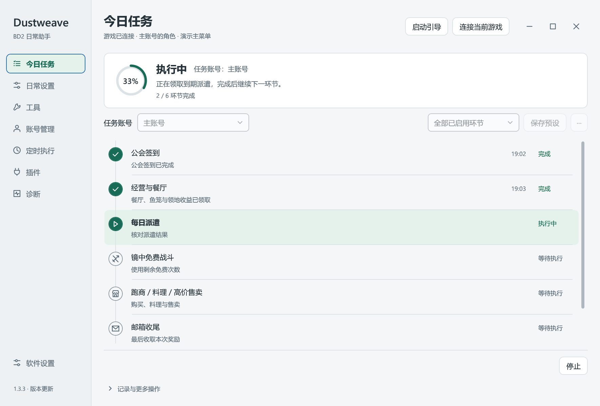
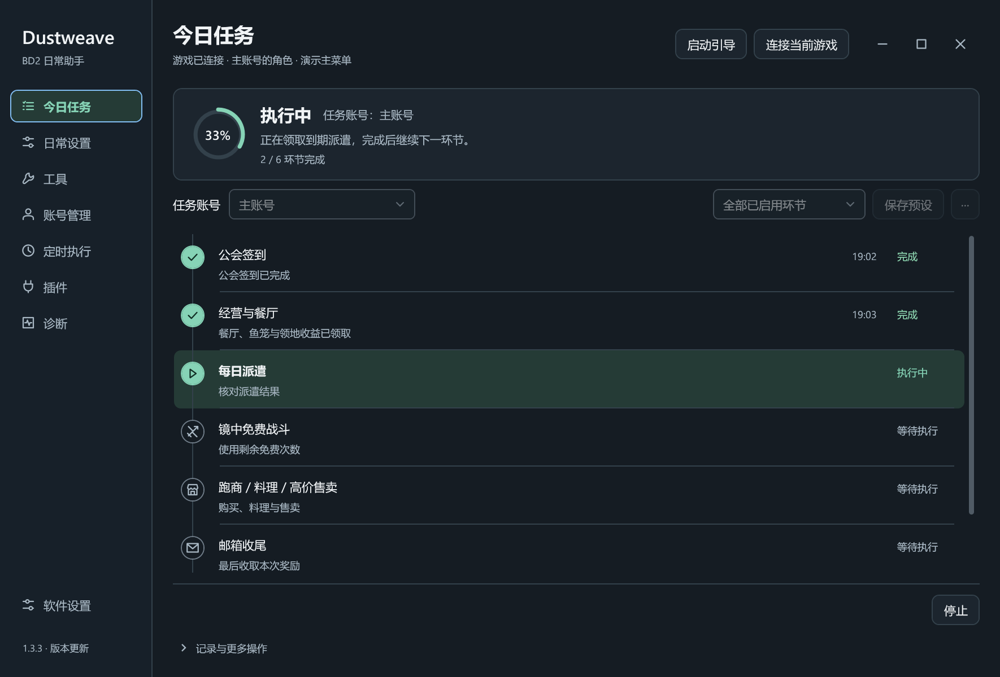

<div align="center">

# Dustweave · 织尘

**把琐碎日常，织成有序时间线。**

BrownDust II 多账号日常助手 · Windows 桌面应用

简体中文 · [English](README.en.md)

[](LICENSE) [](https://github.com/MadestSamurai/Dustweave/releases/latest)   

[开始使用](docs/GETTING_STARTED.md) · [版本发布](https://github.com/MadestSamurai/Dustweave/releases) · [问题反馈](https://github.com/MadestSamurai/Dustweave/issues) · [参与贡献](CONTRIBUTING.md)

</div>

> 本项目由 B 站 **MadSamurai**（GitHub：[MadestSamurai](https://github.com/MadestSamurai)）免费提供，不隶属于游戏官方。辅助工具可能带来账号或游戏运行风险，请了解相关规则并自行决定是否使用。

织尘将账号切换、日常与周常、经营和小游戏收进同一个工作台。为每个账号选择需要的环节，查看本次计划，再沿时间线执行；不需要的环节可以关闭，未完成的部分可以单独重跑。

## 支持开发

如果织尘帮你省下了时间，欢迎请作者喝杯咖啡，支持持续开发与维护。赞助完全自愿，不影响软件功能或使用权限；反馈问题、完善文档和参与翻译，同样是对项目的支持。

[](https://ko-fi.com/D7C1277FLT)

电脑端可直接点击上方 Ko-fi 按钮；微信和支付宝请使用对应应用扫码。[查看二维码原图](docs/images/support-dustweave-zh.png)。谢谢你的支持！

<details>
<summary>展开二维码（Ko-fi / 微信 / 支付宝）</summary>



</details>

## 界面预览



<details>
<summary>查看深色界面</summary>



</details>

截图来自软件的隔离演示模式，使用虚拟账号；支持浅色、深色及跟随系统。

## 能做什么

| 能力 | 用法 |
| --- | --- |
| 多账号管理 | 保存本机账号会话，为各账号选择任务预设；按顺序执行，或通过 Sandboxie 隔离多开 |
| 日常与周常 | 签到、经营奖励、好感度咨询、免费抽取、装备分解与精炼、狩猎、派遣、镜中之战、活动战斗、救赎之塔扫荡、任务与通行证奖励、邮箱领取等 |
| 地图与经营 | 按需启用周收集、周 NPC 任务、偷窃、跑商、料理与高价售卖，以及藏红花种收流程 |
| 清晰的执行计划 | 分环节显示进度与原因，保存任务预设、接续队列或补跑选中项；完成后查看汇总，可设置通知与退出游戏 |
| 一次连接，多个工具 | 日常与内置工具共用连接；按自动化启用状态协调使用，避免同时操作游戏 |
| 定时执行与更新 | 每天固定时间和账号队列；后台下载签名更新包，空闲时确认重启 |
| 全局语言与外观 | 简体中文、繁體中文、English；主窗口和内置工具统一切换语言 |
| 诊断与空间管理 | 一键导出诊断包，统计日志与缓存占用，按保留规则清理，并可迁移缓存位置 |

部分环节依赖账号已解锁的内容、当前活动或游戏版本。支持可选插件，界面按当前可用功能显示。

### 工具箱

以下工具均可从织尘的**工具**页打开，无需另装独立版。内置版本在本仓库维护，随织尘更新；连接准备、自动运行与结算期间统一协调控制权，避免多个功能同时操作游戏。

| 工具 | 主要功能 |
| --- | --- |
| 自动钓鱼 | 钓鱼、鱼饵管理、保留规则与背包出售 |
| 领地自动化 | 种植、采集、料理、库存出售与布局 |
| [装备助手](src/Equipment) | 搓粉规划与批量精炼，确认预算后执行 |
| 连连看 | 盘面求解与续局 |
| [音游](src/Rhythm) | 读取谱面并自动操作 |
| [使徒运气防守](src/ApostleDefense) | 采用离线退火优化的策略，自动召唤、合成、培养、布局与阶段重开 |
| SECRET VISION | 自动圈地、避让与失败重试 |
| [恶魔猎人](src/FiendHunter) | 选择角色、巴萨卡或炎虎及单人难度，结算后停止 |
| [无限抽抽乐](src/InfiniteGacha) | 双列表目标、停止条件与命中通知 |
| [MANSION RUNAWAY](docs/MANSION_RUNAWAY.md) | 实时寻路、避敌与关卡推进，也可选择刷到 80 连锁后停止 |
| [潘多拉大逃脱](docs/PANDORA.md) | 指定关卡循环刷货币；挑战模式支持角色选择、武器与辅助道具配对、BOSS 避让及后期生存决策，确认通关后停止 |

潘多拉挑战策略已有一次实机坚持到 20 分钟的记录；角色养成与随机局仍会影响结果。可关闭自动选装备，改由自己选择。

<details>
<summary>原独立仓库与维护说明</summary>

原仓库用于查阅独立版源码与历史发行；不能据此判断织尘内置版的功能或更新进度。**装备助手、使徒运气防守、无限抽抽乐、恶魔猎人、音游、SECRET VISION 与连连看原仓库已归档并停止维护，后续代码与反馈统一转到 Dustweave。**其余下列仓库截至 2026-10-20 尚未归档，但与内置版不保证同步发布。

- [装备助手（已归档）](https://github.com/MadestSamurai/bd2-equipment-assistant)
- [自动钓鱼](https://github.com/MadestSamurai/bd2-fishing) · [领地自动化](https://github.com/MadestSamurai/bd2-territory)
- [连连看（已归档）](https://github.com/MadestSamurai/bd2-sichuan) · [音游（已归档）](https://github.com/MadestSamurai/bd2-rhythm) · [使徒运气防守（已归档）](https://github.com/MadestSamurai/bd2-apostle-defense)
- [SECRET VISION（已归档）](https://github.com/MadestSamurai/bd2-secret-vision) · [恶魔猎人（已归档）](https://github.com/MadestSamurai/bd2-fiend-hunter) · [无限抽抽乐（已归档）](https://github.com/MadestSamurai/bd2-infinite-gacha)

装备助手、使徒运气防守、无限抽抽乐、恶魔猎人、音游、MANSION RUNAWAY 与潘多拉分别在 [`src/Equipment/`](src/Equipment)、[`src/ApostleDefense/`](src/ApostleDefense)、[`src/InfiniteGacha/`](src/InfiniteGacha)、[`src/FiendHunter/`](src/FiendHunter)、[`src/Rhythm/`](src/Rhythm)、[`src/Mansion/`](src/Mansion) 和 [`src/Pandora/`](src/Pandora) 维护；SECRET VISION 与连连看分别在 [`src/SecretVision/`](src/SecretVision) 和 [`src/Sichuan/`](src/Sichuan) 维护；其余独立工具的内置源码位于 [`standalone/`](standalone)。各模块保留原有署名与许可证。

</details>

## 下载与开始

适用于 **Windows x64 + BrownDust II 原生 PC 客户端**。不需要 Python，也不以安卓模拟器为运行目标。

| 分发包 | 适合谁 | 运行要求 |
| --- | --- | --- |
| **Portable** | 希望解压即用，或不确定是否安装了运行时 | 已包含 .NET 8 桌面运行时 |
| **Lite** | 已安装运行时，希望下载更小 | [.NET 8 Desktop Runtime x64](https://dotnet.microsoft.com/en-us/download/dotnet/8.0) |

两种包功能一致。请从 [GitHub 最新发行版](https://github.com/MadestSamurai/Dustweave/releases/latest) 或[作者的夸克下载目录](https://pan.quark.cn/s/0ee553c60c0d?pwd=5AgC)（提取码 **5AgC**）下载完整包。国内更新服务器用于软件内 OTA，不提供首次安装的下载入口。下载后：

1. **完整解压**到自己的文件夹，运行 `Dustweave.exe`。运行库、资源与组件统一放在 `app` 文件夹内，请完整保留，不要只复制 EXE。
2. 按**启动引导**确认游戏位置，试启动并进入主菜单；检测到角色后正常退出游戏，在引导中保存账号。引导可跳过，也可从窗口顶部重新打开。
3. 通过高亮导览了解各个分页；以后在账号列表点击**进入游戏**，避免桌面快捷方式或加速器启动造成权限差异。
4. 在**日常设置**按分类配置环节，再到**今日任务**选好账号，点击顶部的启动按钮；游戏已运行时会直接连接。多账号在**账号管理**勾选账号并执行队列。

首次使用建议先选择少量熟悉的环节。[完整入门](docs/GETTING_STARTED.md)包含更新、数据位置和常见问题。兼容版本优先使用小型差分更新，最多跨 10 次发布；差分包超过 8 MiB、需要更换运行库或版本跨度过大时，提示手动下载。自动更新失败也可完整解压到新目录，已有账号与设置会沿用。1.2 系列及已撤回的 1.3.0 须手动换用完整包，不能沿旧通道升级到当前版本。

游戏不在默认位置时，打开 **软件设置 → 游戏与沙盒位置 → 更改位置**，选择游戏本体 `BrownDust II.exe`。位置自动保存，所有账号和定时执行共用；也可恢复自动查找。Sandboxie 的安装位置也在这里修改。

隔离多开需要安装 [Sandboxie-Plus](https://sandboxie-plus.com/downloads/) 的 Windows x64 稳定版；串行执行无需安装。未检测到时，启动前会提供下载、选择已安装位置和重新检测；软件设置中的 **沙盒工具位置 → 安装与检测** 也可打开帮助。定时任务缺少沙盒时只提示一次，不会停止正在运行的工具；安装后请手动执行，或等待下一次定时任务。

**软件设置**位于侧栏底部，集中管理外观、语言、启动与关闭行为、程序位置及日志清理。可选择登录 Windows 时启动织尘，默认关闭；打开软件后是否执行日常是另一个独立选项。

## 遇到问题

先查看[使用与排错](docs/GETTING_STARTED.md#遇到问题)，再提交 [Issue](https://github.com/MadestSamurai/Dustweave/issues/new/choose)。请写明工具版本、发生的环节、实际现象与复现步骤；需要日志时只附相关时段，并检查其中的账号标识与其他私人信息。

也可在 **诊断 → 导出诊断日志** 一键生成日志 ZIP，选择保存位置后私下发送。微信 **SuJakads0133** · QQ **1104563414**。[导出范围与状态说明](docs/DIAGNOSTICS.md)。更新页提供最新 Release 和作者的夸克下载目录入口。

不要上传整个账号目录、登录凭据、完整库存或回放。安全问题的反馈方式见 [SECURITY.md](SECURITY.md)。

## 参与开发

使用 C#、.NET 和 WPF，通过游戏运行时状态观察、客户端适配和共享连接编排任务。本体不依赖 Python。欢迎提交可复现的问题、翻译、文档改进和聚焦的修复。

```powershell
git clone https://github.com/MadestSamurai/Dustweave.git
cd Dustweave
.\build.ps1
.\test.ps1 -NoBuild
.\check-source.ps1 -AfterBuild
```

普通构建与合成测试不需要安装游戏，也不会连接游戏；开发环境和打包方式见[开发指南](docs/DEVELOPMENT.md)。

[贡献指南](CONTRIBUTING.md) · [项目架构](docs/ARCHITECTURE.md) · [测试范围](tests/Dustweave.Tests/README.md) · [变更记录](CHANGELOG.md)

## 许可与致谢

Dustweave 主体采用 [MIT 许可证](LICENSE)。内置独立工具与第三方组件保留各自许可证；MIT 不授予游戏代码、资源或商标的权利。见 [THIRD_PARTY_NOTICES.md](THIRD_PARTY_NOTICES.md) 和[依赖清单](docs/DEPENDENCIES.md)。游戏及其素材的权利归各自权利人所有。

感谢独立工具维护者、依赖项目，以及提供测试反馈、翻译和问题复现的用户。项目免费提供，不出售激活码或付费授权；请通过本仓库及作者发布渠道核对来源。

从旧版本升级：完整解压到新目录，启动 `Dustweave.exe`；已有账号、设置和历史会自动沿用，无需迁移数据。不要将新旧程序混放在同一目录。
